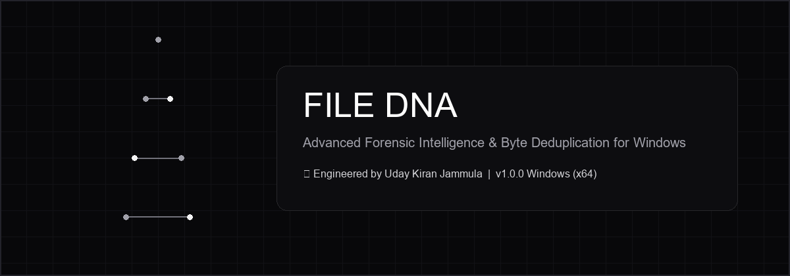

<div align="center">



# FILEDNA 2.0
### Digital File Intelligence • Cross-Platform Ecosystem for Windows & Android

[](https://github.com/Udaykiranjammula-alpha/file-dna/releases)
[](https://github.com/Udaykiranjammula-alpha/file-dna/releases)
[](LICENSE)
[](https://github.com/Udaykiranjammula-alpha)

<p align="center">
  <strong>FileDNA</strong> is an advanced, privacy-first digital file intelligence ecosystem. Scan, inspect, analyze, convert, organize, verify, and understand files across <strong>Windows desktop computers</strong> and <strong>Android mobile devices</strong> from one unified architecture.
</p>

---

### ⚡ Direct Deliverables & Verified Checksums

| Platform | Target Package | Location | SHA-256 Checksum |
| :--- | :--- | :--- | :--- |
| **Windows** | Portable Executable | `release/File-DNA-Portable-1.0.0.exe` | `7C98FDF4A36D91BEF60B3FE14DADE22294A97FF18589197B20CF975231CC33A0` |
| **Windows** | NSIS Setup Wizard | `release/File DNA-Setup-1.0.0.exe` | `FCF91AB1BFAA21BDA236E319844F3BCE41E3E7FA293FAC49B5E23C1A46B2082C` |
| **Android** | Debug Signed APK | `android/release/FileDNA-debug.apk` | `A95B77DDDDD5C7414C4D1DBE1BAC0E3C6F770679B2693A89A5A6D227779AA35F` |

</div>

---

## 🧬 Core Intelligence Capabilities

### 1. Multi-Algorithm Cryptographic Signatures
FileDNA calculates **SHA-256**, **MD5**, **SHA-1**, and **CRC-32** checksums concurrently in non-blocking byte streams without loading entire files into memory.

### 2. Shannon Entropy Profiling & 16-Bucket Density Barcode
Quantifies the mathematical randomness of data ($0.0$ to $8.0$ bits/byte):
$$H(X) = -\sum_{i=0}^{255} P(x_i) \log_2 P(x_i)$$
- **0.0 - 1.0**: Zeroed / Sparse padding.
- **1.0 - 3.5**: Plain text, Markdown, scripts, and structured code.
- **3.5 - 5.5**: Formatted office documents, XML, JSON, and database records.
- **5.5 - 7.2**: Native binaries, DLLs, and uncompressed media.
- **7.2 - 8.0**: High-entropy compressed archives or encrypted streams.

### 3. Magic Byte Detection & Extension Mismatch Warning
Inspects low-level header magic bytes for over 30 formats (PE/MZ, PDF, ZIP/APK/DOCX, PNG, JPEG, GIF, RAR, 7Z, MP3, MP4). Flags critical discrepancies when executable binaries disguise themselves as innocuous extensions.

### 4. Duplicate Content Vault & Space Reclamation
Groups exact byte-for-byte duplicates regardless of filename or folder path. Computes recoverable storage and dispatches redundant files safely to the Windows Recycle Bin.

### 5. Complete PDF Toolkit
- **Create**: Text to PDF with configurable margins, fonts, page sizes (A4/Letter), and multi-image combination.
- **Organize**: Merge multiple PDFs, split into page ranges, extract pages, rotate pages, and reorder.
- **Enhance**: Add custom text watermarks, headers, footers, and page numbers.
- **Inspect**: Extract text, view metadata, and inspect encryption status.

### 6. File Converter & Archive Operations
- **Images**: Fast conversions among PNG, JPEG, WebP, TIFF, BMP with resizing and compression.
- **Archives**: Create and inspect ZIP archives with path traversal (`../`) and zip-bomb ratio checks.
- **Data**: JSON pretty-printing and validation, CSV previewing, and batch rename rules.

### 7. Multi-Format Audit Reports
Export forensic audit reports in **JSON**, **CSV**, **HTML** (XSS-sanitized), **TXT**, and **PDF**.

---

## 📱 Android Mobile Application

FileDNA Android is a native mobile application designed with Material 3 styling and scoped storage support:
- **Storage Access Framework (SAF)**: Inspects files and directories with explicit user authorization.
- **Streaming Analysis**: Computes SHA-256, MD5, and Shannon entropy without exceeding mobile RAM.
- **Native PDF Creation**: Generates valid multi-page PDF documents via Android's native `android.graphics.pdf.PdfDocument`.
- **System Sharing**: Share generated audit reports directly via Android's native Share Sheet.

---

## 🛠️ Build and Verification Instructions

### Prerequisites
- **Node.js**: v18.0.0+ (v24.x tested)
- **Windows**: 10 or 11 (64-bit)
- **Java/JDK**: OpenJDK 17+ (JDK 25 tested)
- **Android SDK**: Build-Tools 36.0.0+ & Platform android-37.0+

### Windows Desktop Build
```bash
# 1. Run Automated Test Suite
npm test

# 2. Build Portable Executable (.exe)
npm run dist:portable

# 3. Build Full NSIS Windows Installer (.exe)
npm run dist:nsis
```

### Android APK Build
```powershell
# Build, align, and sign the Android APK
powershell -ExecutionPolicy Bypass -File android/build-apk.ps1
```

---

## 🏗️ Project Architecture

```
file-dna/
├── assets/                  # Icons and banner art
├── electron/
│   ├── main.js              # Electron main process & IPC coordinator
│   ├── preload.js           # Context-isolated secure preload bridge
│   └── services/            # FileDNA Core Engines
│       ├── scan-engine.js       # Background recursive directory scanner
│       ├── forensic-engine.js   # Hashes, entropy, magic bytes & hex dump
│       ├── pdf-engine.js        # PDF generation, merge, split, text extraction
│       ├── converter-engine.js  # Sharp image conversion & archive tools
│       ├── metadata-engine.js   # EXIF, audio, document metadata extractor
│       └── report-engine.js     # Sanitized JSON, CSV, HTML, TXT, PDF exporter
├── renderer/
│   ├── index.html           # Obsidian dark & light theme UI
│   ├── css/styles.css       # Design system & responsive layout
│   └── js/app.js            # Frontend reactive controller & tools
├── android/                 # Native Android application module
│   ├── build-apk.ps1        # Standalone build & signing script
│   ├── app/
│   │   ├── build.gradle.kts # Android module Gradle configuration
│   │   └── src/main/
│   │       ├── AndroidManifest.xml
│   │       ├── res/         # Layouts, colors, drawables, strings
│   │       └── java/com/filedna/app/
│   │           ├── MainActivity.java
│   │           └── core/    # Native mobile hashing, entropy, PDF & reports
│   └── release/             # Generated signed APKs
├── tests/
│   └── test-core-engine.js  # Automated test suite (15 test vectors)
├── release/                 # Generated Windows portable and setup binaries
├── LICENSE                  # MIT License
├── package.json             # NPM package scripts & dependencies
├── SECURITY.md              # Security and vulnerability policy
└── README.md                # Project documentation
```

---

## 🛡️ License

Distributed under the **MIT License**. See [`LICENSE`](LICENSE) for complete terms.

---

## 👤 Architect

**Uday Kiran Jammula**  
GitHub: [@Udaykiranjammula-alpha](https://github.com/Udaykiranjammula-alpha)  
Email: `2500031243@kluniversity.in`
